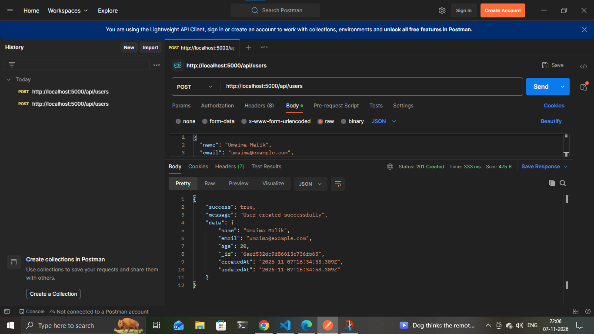
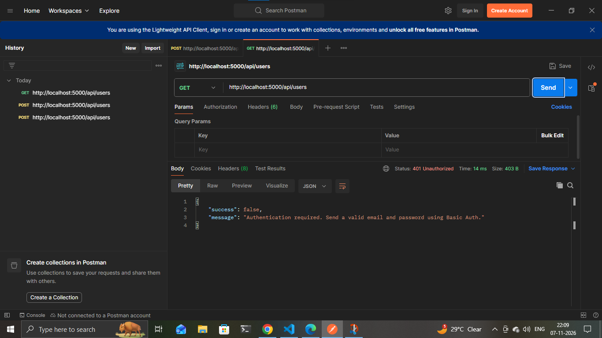
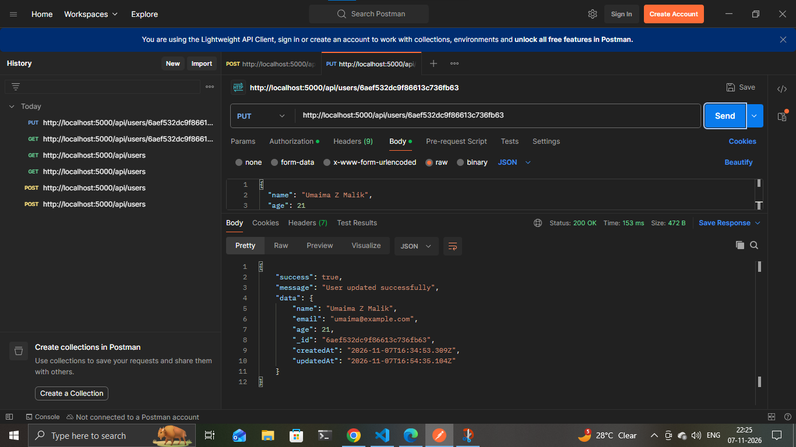
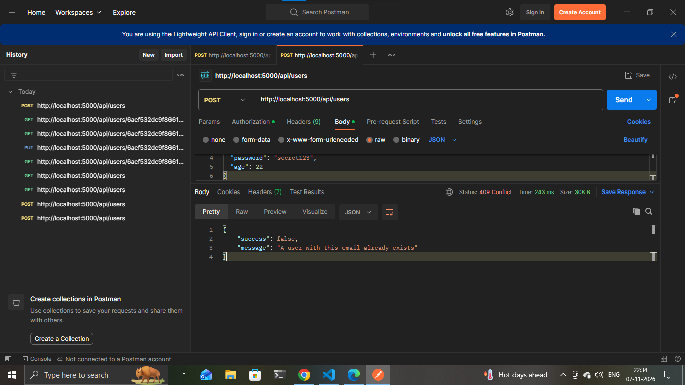
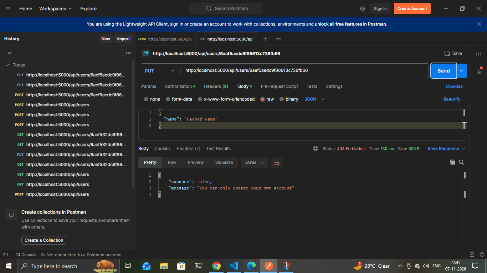
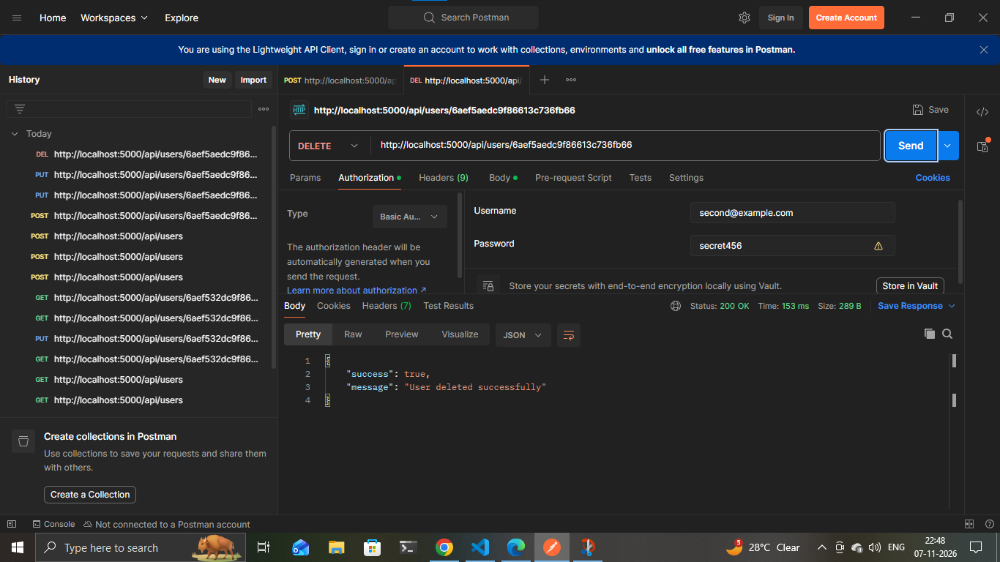

# User Management System (REST API)

A RESTful API for managing users, built with Node.js, Express, MongoDB and Mongoose. It supports full CRUD operations and secures its endpoints with Basic Authentication.


## Features
- Create, read, update and delete users
- MongoDB storage with a Mongoose schema and validation
- Passwords hashed with bcrypt and never returned in responses
- Basic Authentication on protected endpoints
- Users can only update or delete their own account
- Clear error responses (400, 401, 403, 404, 409)

## Tech Stack
Node.js, Express, MongoDB, Mongoose, bcryptjs, dotenv, Postman

## Getting Started
1. Install [Node.js](https://nodejs.org) and [MongoDB](https://www.mongodb.com/try/download/community).
2. Install dependencies:
   ```
   npm install
   ```
3. Create a `.env` file (see `.env.example`):
   ```
   PORT=5000
   MONGO_URI=mongodb://127.0.0.1:27017/user_management
   ```
4. Start the server:
   ```
   npm run dev
   ```
   The API runs at `http://localhost:5000`.

## API Endpoints
| Method | Endpoint | Auth | Description |
|---|---|---|---|
| POST | `/api/users` | No | Create a user |
| GET | `/api/users` | Yes | Get all users |
| GET | `/api/users/:id` | Yes | Get one user |
| PUT / PATCH | `/api/users/:id` | Yes | Update your own account |
| DELETE | `/api/users/:id` | Yes | Delete your own account |

## Authentication
Protected routes use Basic Auth. Send your email as the username and your password as the password. In Postman, open the Authorization tab and choose Basic Auth.

## Example Request
`POST /api/users`
```json
{
  "name": "Umaima Malik",
  "email": "umaima@example.com",
  "password": "secret123",
  "age": 20
}
```

## Postman Testing
| Test | Result |
|---|---|
| Create user | 201 Created |
| Request without login | 401 Unauthorized |
| Get all users with login | 200 OK |
| Get one user | 200 OK |
| Update user | 200 OK |
| Wrong password | 401 Unauthorized |
| Duplicate email | 409 Conflict |
| Invalid data | 400 Bad Request |
| Update another user's account | 403 Forbidden |
| Delete user | 200 OK |
| Get deleted user | 404 Not Found |

### Screenshots








## Author
Umaima Malik — [GitHub](https://github.com/umaima8920) · [LinkedIn](https://www.linkedin.com/in/umaima-malik-62a4213a7)